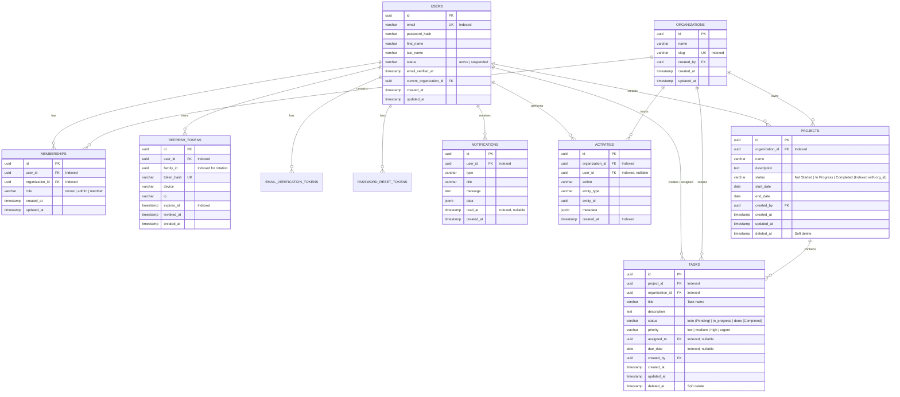

# Flowtide Database Schema & Entity-Relationship (ER) Documentation

This document describes the relational database schema implemented in PostgreSQL for the Flowtide platform.

---

## 1. Entity-Relationship Diagram (ERD)

---

## 2. Table Specifications & Constraints

### 2.1 `users`
- **Primary Key:** `id` (UUID, `gen_random_uuid()`)
- **Unique Index:** `email` (lowercased)
- **Relationships:**
  - `current_organization_id` references `organizations(id)` (nullable, set during login/registration)

### 2.2 `organizations`
- **Primary Key:** `id` (UUID)
- **Unique Index:** `slug`
- **Multi-Tenant Scoping:** All core business objects (`projects`, `tasks`, `activities`, `memberships`) carry `organization_id` foreign keys with database-level cascading or soft-delete safety.

### 2.3 `projects`
- **Primary Key:** `id` (UUID)
- **Foreign Keys:**
  - `organization_id` references `organizations(id)`
  - `created_by` references `users(id)`
- **Composite Index:** `(organization_id, status)` for instantaneous status-filtered project retrieval.
- **Assignment Attributes:**
  - `status`: `'Not Started'`, `'In Progress'`, `'Completed'`
  - `start_date`: optional project start date
  - `end_date`: optional project target delivery date (`start_date <= end_date`)

### 2.4 `tasks`
- **Primary Key:** `id` (UUID)
- **Foreign Keys:**
  - `project_id` references `projects(id)` ON DELETE CASCADE
  - `organization_id` references `organizations(id)`
  - `assigned_to` references `users(id)` (nullable)
  - `created_by` references `users(id)`
- **Composite Indexes:**
  - `(project_id, status)`
  - `(organization_id, status)`
  - `(organization_id, due_date)`
- **Assignment Attributes:**
  - `title` / name: Task title
  - `status`: `'todo'` (`'Pending'`), `'in_progress'` (`'In Progress'`), `'done'` (`'Completed'`)
  - `priority`: `'low'`, `'medium'`, `'high'`
  - `due_date`: optional deadline date

---

## 3. Data Integrity & Security Guarantees
1. **Relational Constraints:** Foreign keys strictly enforced in PostgreSQL engine.
2. **Multi-Tenant Ownership Isolation:** Queries are scoped at the ORM repository layer by `organizationId`, preventing cross-tenant and cross-user data leakage.
3. **No Plaintext Passwords:** Passwords hashed with Argon2id using cryptographically secure salts.
4. **Token Security:** Refresh tokens stored only as cryptographic hashes with token family rotation tracking to detect replay attacks.
